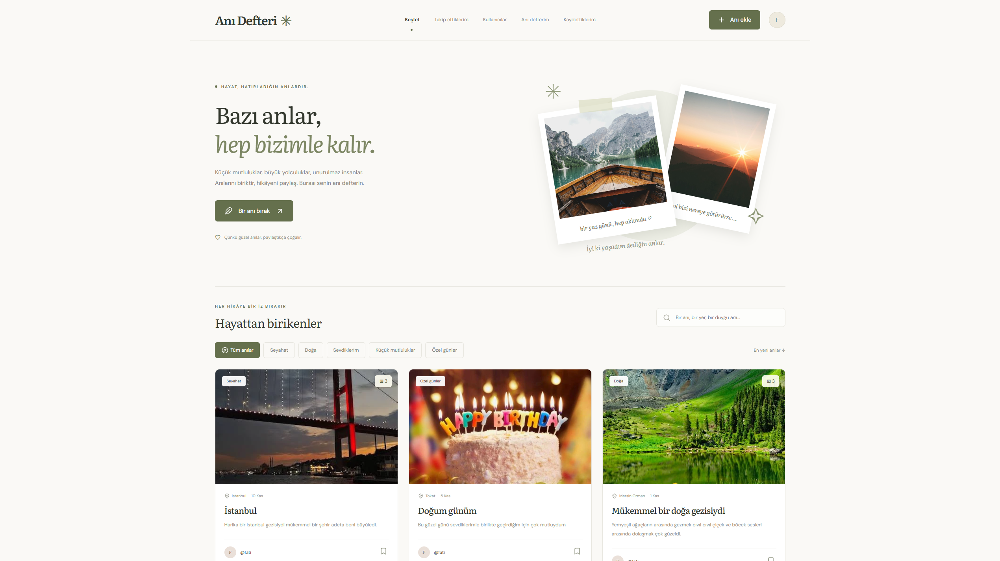
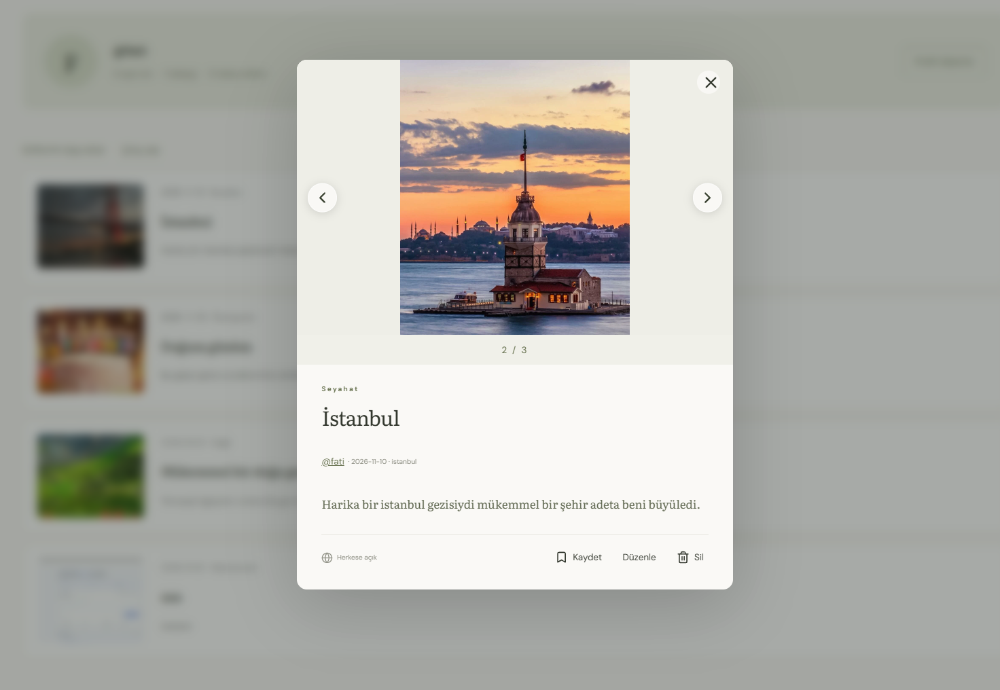
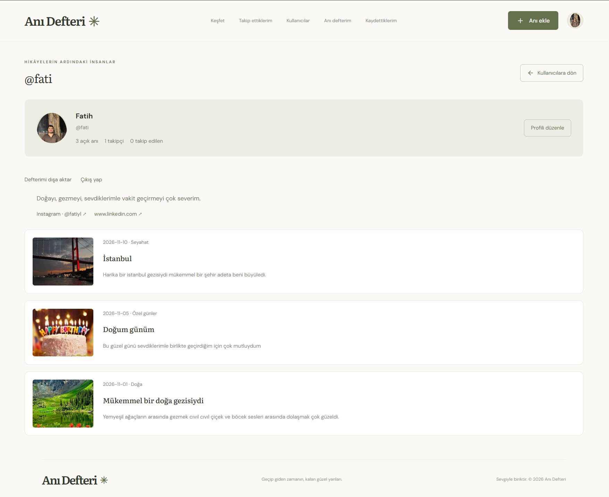
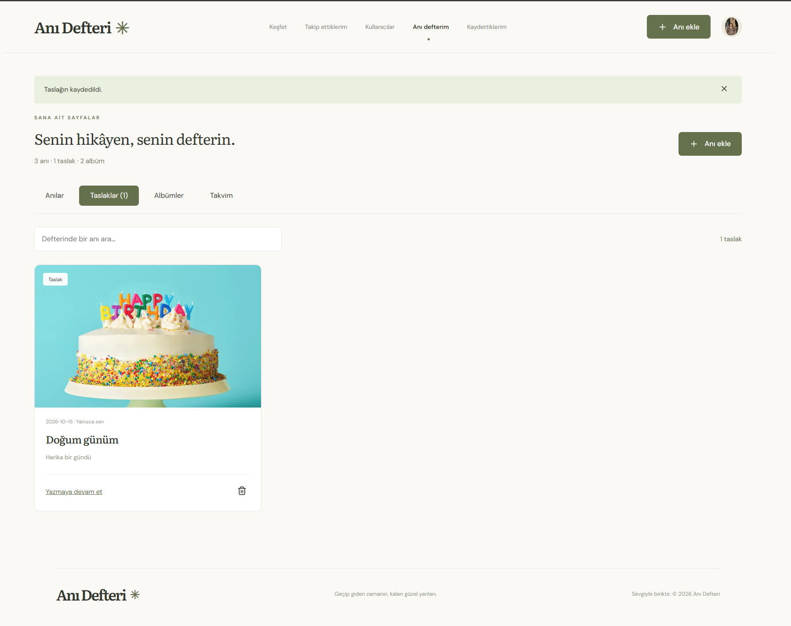
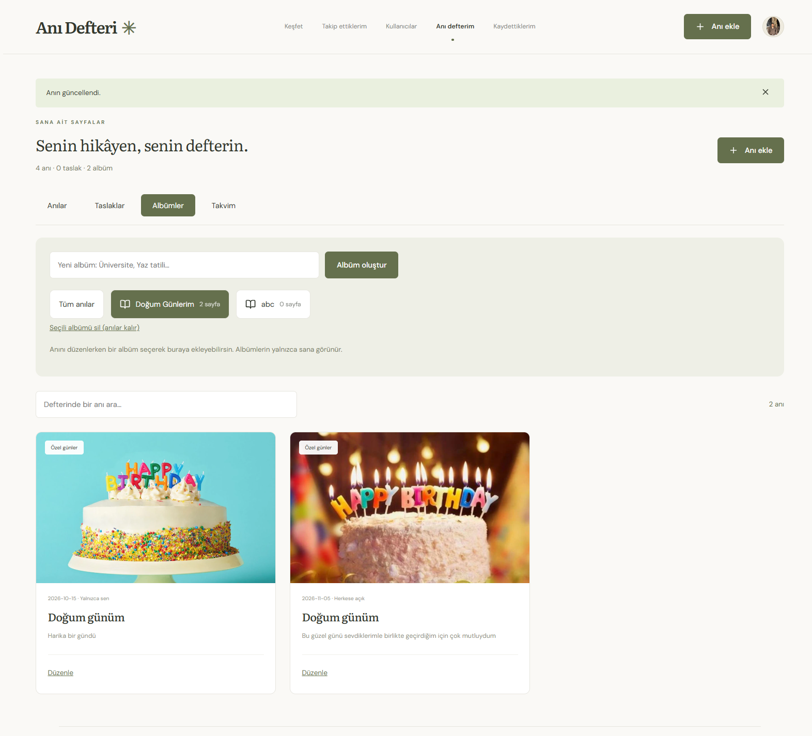
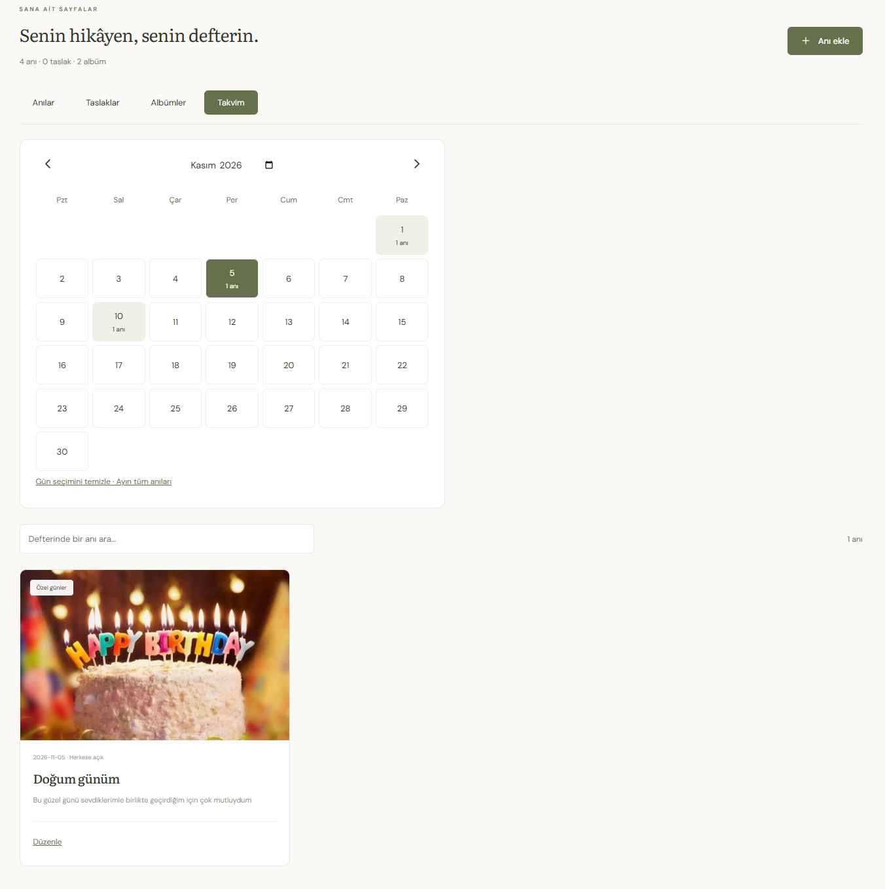

# Anı Defteri

Fotoğraflı anıları biriktirmek, kişisel albümlerde düzenlemek ve diğer kullanıcılarla paylaşmak için geliştirdiğimiz web uygulaması.

Anı Defteri, sosyal paylaşım ile kişisel günlük kullanımını birleştirir. Kullanıcılar anılarını herkese açık paylaşabilir veya yalnızca kendilerinin görebileceği şekilde saklayabilir.



## Özellikler

- **Hesap ve profil:** Kullanıcı adı, e-posta ve şifreyle kayıt; profil fotoğrafı, biyografi ve sosyal bağlantılar.
- **Sosyal paylaşım:** Kullanıcı arama, takip etme, takip edilenlerin anılarını görüntüleme ve anıları kaydetme.
- **Çoklu fotoğraf:** Anı başına en fazla 10 fotoğraf, kapak seçimi için sıralama, galeri okları ve fotoğraf sayacı.
- **Anı düzenleme:** Başlık, hikâye, tarih, konum, kategori, görünürlük ve fotoğrafları güncelleme.
- **Otomatik taslak:** Yazmaya ara verildiğinde kaydedilen taslağa daha sonra devam etme.
- **Kişisel albümler:** Anıları albümlerde toplama; albüm silindiğinde anıları koruma.
- **Takvim:** Anıları tarihlerine göre ay ve gün bazında görüntüleme.
- **Bugün, geçmişte:** Önceki yılların aynı günündeki anıları yalnızca sahibine hatırlatma.
- **Gizlilik:** Herkese açık ve yalnızca sahibine görünen anılar; diğer kullanıcılardan gizlenen taslaklar.
- **Hesap işlemleri:** E-posta doğrulama, şifre yenileme ve hesap verilerini dışa aktarma.

## Ekran görüntüleri

### Anı detayı ve fotoğraf galerisi



### Kullanıcı profili



### Taslaklar



### Kişisel albümler



### Takvim



## Teknolojiler

| Katman | Kullanılan teknolojiler |
| --- | --- |
| Arayüz | React, TypeScript, Vite |
| Sunucu | Python, Django, Gunicorn |
| Veritabanı | PostgreSQL |
| Oturum yönetimi | Django oturumları, HttpOnly çerezler, CSRF koruması |
| Görsel işleme | Pillow |
| Yerel taslak kurtarma | IndexedDB |
| Çalıştırma | Docker, Docker Compose, Nginx |
| Yayın yapılandırması | Caddy, HTTPS, SMTP |
| Otomatik kontroller | GitHub Actions, Django testleri, TypeScript kontrolü |

## Mimari ve uygulama kararları

React arayüzü `/api` uçları üzerinden Django ile iletişim kurar. Docker kurulumunda Nginx arayüz dosyalarını sunar ve API isteklerini backend'e yönlendirir. Django verileri PostgreSQL'de saklar.

- Kullanıcılar, anılar, albümler, takip ilişkileri ve kaydedilen anılar ilişkisel veritabanında tutulur.
- Fotoğraflar ve profil görselleri de veritabanında saklanır. Böylece veritabanı yedeği görselleri de kapsar.
- Yüklenen görseller doğrulanır, yeniden işlenir ve EXIF bilgileri kaldırılır.
- Özel anılara ve fotoğraflara erişim sunucu tarafında kontrol edilir.
- Taslaklar sunucuya otomatik kaydedilir. Gönderim öncesinde aynı cihazda hesap bazlı bir kurtarma kopyası tutulur.
- Düzenleme sırasında kayıt sürümü kontrol edilir; başka pencerede yapılan değişikliğin üzerine sessizce yazılması engellenir.
- Albümler kişiseldir. Bir albümün silinmesi içindeki anıları silmez.

## Yerel kurulum

### Gereksinimler

- Docker Desktop ve Docker Compose
- Windows'ta PowerShell

### Başlatma

Projeyi indirdikten sonra proje kökünde çalıştır:

```powershell
powershell -NoProfile -ExecutionPolicy Bypass -File .\Baslat.ps1
```

Betik ilk çalıştırmada `.env` dosyasını oluşturur, rastgele uygulama anahtarı ve veritabanı parolası üretir, servisleri derleyerek başlatır. Var olan `.env` dosyasını korur.

- Uygulama: http://localhost:3000
- Kayıt ve giriş: http://localhost:3000/hesap

Yeni kurulumda hazır kullanıcı hesabı bulunmaz. Kayıt ekranından kendi hesabını oluşturabilirsin.

Yerel modda varsayılan olarak e-posta doğrulaması zorunlu değildir. Üretim yapılandırması gerçek SMTP ayarları ve e-posta doğrulaması gerektirir.

### Servis yönetimi

```powershell
docker compose ps
docker compose stop
docker compose start
```

PostgreSQL verileri kalıcı Docker biriminde tutulur. `docker compose down -v` komutu bu birimi ve içindeki verileri siler.

## Testler ve otomatik kontroller

Backend testlerini çalıştırmak için:

```powershell
docker compose exec backend python manage.py test journal
```

Yerel Docker ve PostgreSQL ortamında **7 test başarıyla geçti**.

Test kapsamı:

- Kayıt, oturum açma ve kapatma
- E-posta doğrulama ve şifre yenileme
- CSRF koruması
- Profil, takip ve kaydedilen anılar
- Özel anıların ve taslakların erişim kontrolü
- Fotoğraf sıralama, kaldırma ve geçersiz yüklemeler
- Çakışan düzenlemelerin engellenmesi
- Albüm sahipliği ve silme davranışı
- Yıldönümü anılarının tarih ve kullanıcı filtreleri

Arayüzün TypeScript kontrolünü ve üretim derlemesini çalıştırmak için Node.js 22.13 veya üzeriyle:

```powershell
cd frontend
npm ci
npm run build
```

GitHub Actions iş akışı her push ve pull request için iki bağımsız kontrol çalıştıracak şekilde yapılandırılmıştır:

1. PostgreSQL üzerinde Django kontrolleri, migration kontrolü ve backend testleri.
2. TypeScript kontrolü ve arayüzün üretim derlemesi.

## Proje yapısı

| Konum | Açıklama |
| --- | --- |
| `frontend/app/` | Arayüz bileşenleri ve API iletişimi |
| `backend/journal/` | Veri modelleri, API işlemleri ve testler |
| `backend/journal/migrations/` | Veritabanı şema değişiklikleri |
| `backend/config/` | Django ayarları ve URL tanımları |
| `.github/workflows/ci.yml` | Otomatik test ve derleme iş akışı |
| `docs/screenshots/` | Uygulama ekran görüntüleri |
| `scripts/` | Yedekleme betikleri |
| `compose.yaml` | Yerel Docker kurulumu |
| `compose.production.yaml` | Üretim ortamı yapılandırması |

## Yayın ve yedekleme

Proje yerel ortamda çalıştırılmış ve test edilmiştir. Henüz herkese açık bir canlı yayını bulunmamaktadır.

- [Sunucuda yayınlama](docs/YAYIN.md)
- [Veritabanını yedekleme](docs/YEDEKLEME.md)
- [Görsel ve yazı tipi kaynakları](docs/VARLIKLAR.md)

Gerçek ortam ayarları, parolalar, veritabanı dosyaları ve yedekler kaynak kod deposuna dahil edilmez. `.env.example` yapılandırma örneği olarak sunulur.

## Geliştiriciler

Bu proje **Fatih Yılmaz** ve **Gamze Özateş** tarafından birlikte geliştirilmiştir.

### Fatih Yılmaz

- [GitHub](https://github.com/fathylmaz)
- [LinkedIn](https://www.linkedin.com/in/fathylmaz/)

### Gamze Özateş

- [GitHub](https://github.com/gamzeozates)
- [LinkedIn](https://www.linkedin.com/in/gamze-ozates-797026330/)